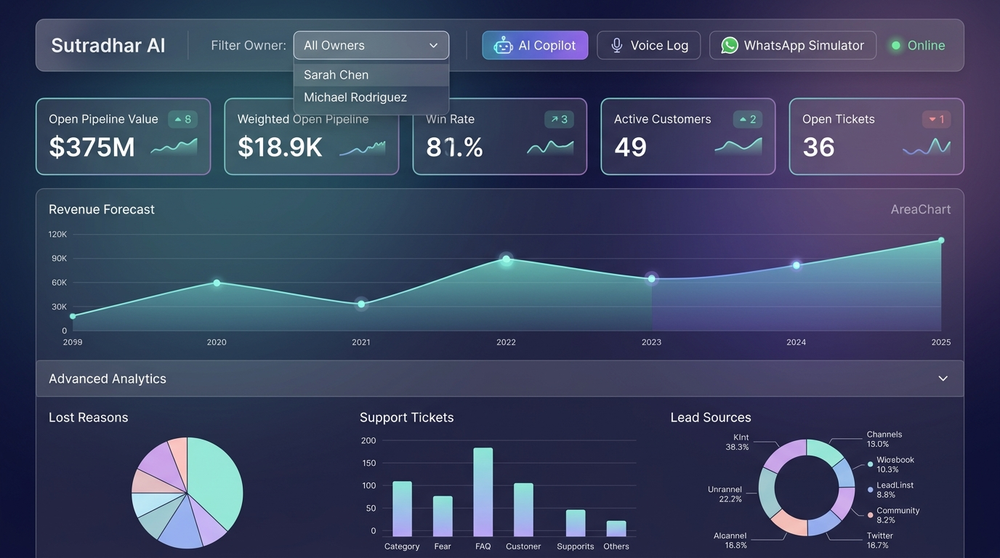
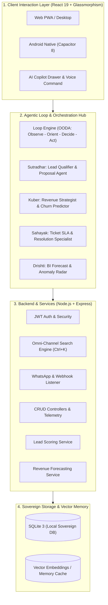
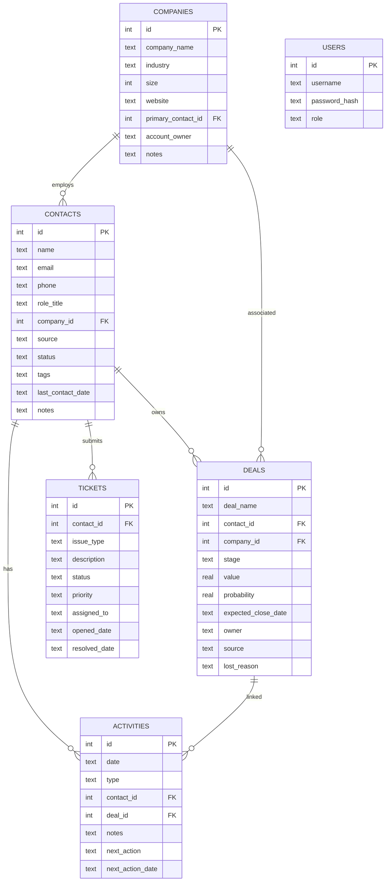

<p align="center">
  
</p>

<h1 align="center">Sutradhar AI</h1>
<p align="center">
  <strong>Self-Hosted Autonomous Multi-Agent Revenue Command Center</strong>
</p>

<p align="center">
  <a href="https://react.dev/"></a>
  <a href="https://nodejs.org/"></a>
  <a href="https://expressjs.com/"></a>
  <a href="https://sqlite.org/"></a>
  <a href="https://capacitorjs.com/"></a>
  <a href="https://vitejs.dev/"></a>
</p>

<p align="center">
  <a href="#-quick-start"></a>
  
  
  
</p>

<p align="center">
  A premium, glassmorphic dark-theme <strong>AI-powered CRM &amp; Revenue Command Center</strong> engineered for businesses that demand<br/>
  <strong>100% data sovereignty</strong>, <strong>zero SaaS fees</strong>, <strong>autonomous AI agents</strong>, and <strong>offline-first capabilities</strong>.
</p>

---

## 📸 Dashboard Overview

<p align="center">
  
</p>

> The dashboard features a premium **glassmorphic dark theme** with an HSL-tuned color palette, live KPI cards, Revenue Forecast charts, AI Copilot drawer, Deal Risk Radar, and Advanced Analytics — all in real-time.

---

## 📋 Table of Contents

- [Why Sutradhar AI?](#-why-sutradhar-ai)
- [Features](#-features)
- [AI Agents & Autonomous Loop](#-ai-agents--autonomous-loop)
- [High-Level Architecture](#-high-level-architecture--agentic-loop)
- [Quick Start](#-quick-start)
- [Project Structure](#-project-structure)
- [API Reference](#-api-reference)
- [Mobile App (Android)](#-mobile-app-android)
- [Deployment](#-deployment)
- [Environment Variables](#-environment-variables)
- [Database Schema](#-database-schema)
- [Roadmap](#-roadmap)
- [Contributing](#-contributing)
- [License](#-license)

---

## 🎯 Why Sutradhar AI?

| Challenge | Sutradhar AI Solution |
|-----------|----------------------|
| **Expensive SaaS subscriptions** (Salesforce, HubSpot, Zoho) | Zero recurring fees — own your platform forever |
| **Data stored on third-party servers** | 100% self-hosted — your data never leaves your infrastructure |
| **Vendor lock-in & export limitations** | Single portable SQLite file + CSV export for any table |
| **No offline access** | PWA + Android APK with offline-first architecture |
| **Complex setup & maintenance** | One command to install, one command to run |
| **No AI built in** | Autonomous multi-agent system with Lead Scoring, Revenue Forecasting, Deal Radar & AI Copilot |
| **Generic dashboards** | Premium glassmorphic dark-theme Revenue Command Center with live telemetry |

---

## ✨ Features

### 📊 Revenue Command Center
Live KPI dashboard with interactive **Recharts** visualizations showing:
- Open Pipeline Value & Weighted Forecast
- Win Rate % & Deal Velocity
- Active Contacts & Company Accounts
- Open Ticket Volume & Resolution Metrics
- Monthly Revenue Trends (Area Charts)
- Deal Stage Distribution (Pie Charts)
- Activity Timeline with Type Breakdown

### 🤖 AI-Powered Intelligence
- **Lead Scoring Engine** — `POST /api/lead/score` evaluates leads with a weighted scoring model
- **Revenue Forecasting** — `GET /api/revenue/forecast` provides 6-month revenue predictions (plug-in-ready for ML models)
- **Predictive Deal Risk Radar (Drishti)** — Real-time deal health monitoring with win-probability scores
- **AI Copilot Drawer** — Conversational interface to query pipeline telemetry and get AI recommendations
- **Human-In-The-Loop Review Queue** — Agents propose actions; users approve & dispatch
- **Voice-Log AI** — Auto-transcribe simulated calls and create activity records
- **Audit-Proof Logging** — Tamper-proof enterprise audit trail (SOC2/GDPR ready)

### 👥 Contact Management
- Full CRUD with inline editing and detail panels
- Company association with foreign key integrity
- Source tracking (Web, Referral, WhatsApp, LinkedIn, etc.)
- Status lifecycle management (Lead → Qualified → Customer → Churned)
- Tag-based categorization
- **CSV Import** — bulk import contacts from spreadsheets
- **CSV Export** — one-click data backup & migration

### 🏢 Company Directory
- Complete company profiles with industry, size, and website
- Primary contact linkage
- Account owner assignment
- Related contacts, deals, and activity rollup views

### 🔀 Deals Pipeline
- **Kanban Board** — drag-and-drop stage progression with HTML5 DnD
- **Table View** — sortable, filterable deal grid
- Automatic probability recalibration per stage
- Lost reason capture for deal post-mortems
- Stages: Prospecting → Qualification → Proposal → Negotiation → Closed Won/Lost

### 📅 Activities & Follow-ups
- Activity types: Call, Email, Meeting, Demo, Note, WhatsApp Message
- Next-action scheduling with due date tracking
- Contact & Deal association
- Overdue activity alerts via Notification Center

### 🎫 Support Tickets
- Priority levels: Low, Medium, High, Critical
- Status workflow: Open → In Progress → Resolved → Closed
- Assignment routing to team members
- Resolution date tracking & SLA monitoring

### 🔍 Global Search (`Ctrl + K`)
- Instant keyboard-triggered command palette
- Searches across Contacts, Companies, Deals, and Tickets simultaneously
- Debounced backend SQL search engine
- Click-to-navigate results with context highlighting

### 🔔 Smart Notification Center
- Overdue follow-up alerts
- Today's scheduled activities
- High-priority ticket escalations
- Interactive links that navigate directly to the relevant record

### 💬 WhatsApp Integration Pipeline
- Webhook endpoint for incoming WhatsApp messages
- Auto-creates contacts for new phone numbers
- Logs messages as activities linked to contacts
- Ready for production Twilio/Meta WhatsApp Cloud API replacement

### 📱 Cross-Platform
- **Progressive Web App (PWA)** — installable on any device
- **Android APK** — native app via Capacitor
- **Responsive Design** — optimized for desktop, tablet, and mobile

---

## 🧠 AI Agents & Autonomous Loop

Sutradhar AI operates on an **OODA (Observe-Orient-Decide-Act)** autonomous feedback loop with four specialized agents:

| Agent | Role | Capabilities |
|-------|------|-------------|
| **Sutradhar** | Lead Qualifier & Proposal Agent | Scores leads, drafts enterprise proposals, qualifies contacts |
| **Kuber** | Revenue Strategist & Churn Predictor | Deal closure probability, revenue forecasting, churn analysis |
| **Sahayak** | Ticket SLA & Resolution Specialist | Summarizes high-priority tickets, monitors SLA compliance |
| **Drishti** | BI Forecast & Anomaly Radar | Predictive deal risk radar, pipeline anomaly detection |

### How It Works

```
┌─────────────────────────────────────────────┐
│  OBSERVE  │  Agents scan pipeline, tickets,  │
│           │  deals, and activities in real-   │
│           │  time from SQLite                 │
├───────────┼──────────────────────────────────┤
│  ORIENT   │  Score leads, calculate risk,     │
│           │  identify stalled deals           │
├───────────┼──────────────────────────────────┤
│  DECIDE   │  Propose actions: follow-up       │
│           │  emails, escalations, discounts   │
├───────────┼──────────────────────────────────┤
│  ACT      │  Human approves → system          │
│           │  dispatches (WhatsApp, Email)      │
└─────────────────────────────────────────────┘
```

> **Human-In-The-Loop**: All agent recommendations are staged in the Review Queue. Nothing is dispatched without explicit user approval.

---

## 🏗 High-Level Architecture & Agentic Loop



### Tech Stack

| Layer | Technology | Purpose |
|-------|-----------|---------:|
| **Frontend** | React 19, Vite 8, Recharts, Lucide Icons, TailwindCSS | UI components, charts, icons, styling |
| **Backend** | Node.js, Express 4, JWT | REST API server, authentication |
| **AI Services** | Lead Scoring, Revenue Forecasting, Deal Radar | Plug-in-ready stubs for ML/LLM models |
| **Database** | SQLite 3 with Foreign Keys | Relational data storage (single-file, portable) |
| **Mobile** | Capacitor 8, Android SDK | Native Android APK wrapper |
| **PWA** | Service Worker, Web Manifest | Installable web app with offline support |
| **Build** | Vite (frontend), Gradle (Android) | Asset bundling & APK compilation |
| **Deploy** | Vercel, PowerShell Script | Static hosting & CI/CD automation |

---

## 🚀 Quick Start

### Prerequisites

| Requirement | Version | Check |
|-------------|---------|-------|
| **Node.js** | ≥ 16.x | `node -v` |
| **npm** | ≥ 8.x | `npm -v` |

### 1. Clone & Install

```bash
git clone https://github.com/Mradul-Consultancy/Sutradhar-AI.git
cd Sutradhar-AI
npm run install:all
```

### 2. Launch Development Server

```bash
npm run dev
```

This starts both:
- **Vite dev server** → `http://localhost:5173` (frontend)
- **Express API** → `http://localhost:3000/api` (backend)

### 3. Default Login

```
Username: admin
Password: admin123
```

> ⚠️ Change the default password immediately for production use.

---

## 📂 Project Structure

```
Sutradhar-AI/
├── 📁 backend/                    # Express.js API server
│   ├── server.js                  # Express app setup, middleware, route mounting
│   ├── routes.js                  # All REST API route handlers
│   ├── 📁 services/               # AI service modules
│   │   ├── leadScoring.js         # Lead scoring engine (weighted model)
│   │   └── forecasting.js         # Revenue forecasting service (6-month)
│   ├── auth.js                    # JWT token verification middleware
│   ├── .env                       # Environment variables (JWT secret, ports)
│   ├── reset_db.js                # Database reset utility script
│   ├── set_admin_password.js      # Admin password change utility
│   ├── verify_endpoints.js        # API health check / smoke test
│   └── crm.db                     # SQLite database file (auto-created)
│
├── 📁 frontend/                   # React + Vite client application
│   ├── 📁 src/
│   │   ├── App.jsx                # Root component, navigation, global state
│   │   ├── App.css                # Global styles & glassmorphic theme
│   │   ├── index.css              # Base CSS resets
│   │   ├── main.jsx               # React mount point & SW registration
│   │   ├── 📁 views/
│   │   │   ├── LoginView.jsx      # Authentication form
│   │   │   ├── DashboardView.jsx  # Revenue Command Center (KPIs, AI, charts)
│   │   │   ├── ContactsView.jsx   # Contact CRUD, import/export, details
│   │   │   ├── CompaniesView.jsx  # Company management
│   │   │   ├── PipelineView.jsx   # Kanban board & deal table
│   │   │   ├── ActivitiesView.jsx # Activity log & scheduling
│   │   │   └── TicketsView.jsx    # Support ticket queue
│   │   ├── 📁 components/
│   │   │   ├── LeadScoreCard.jsx  # AI Lead Score display widget
│   │   │   └── RevenueForecastChart.jsx # Recharts revenue forecast area chart
│   │   └── 📁 hooks/
│   │       ├── useLeadScore.js    # Custom hook for lead scoring API
│   │       └── useRevenueForecast.js # Custom hook for revenue forecast API
│   ├── 📁 public/
│   │   ├── manifest.json          # PWA web manifest
│   │   ├── sw.js                  # Service worker for PWA
│   │   ├── logo_icon.png          # App icon (192x192 & 512x512)
│   │   ├── favicon.svg            # Browser tab icon
│   │   ├── app-release.apk        # Signed Android APK (3.66 MB)
│   │   └── apk_qr.png             # QR code for APK download
│   └── vercel.json                # Vercel deployment configuration
│
├── 📁 android/                    # Capacitor Android native project
│   ├── 📁 app/
│   │   ├── build.gradle           # Android build config with signing
│   │   └── debug.keystore         # Debug signing keystore
│   ├── gradlew / gradlew.bat      # Gradle wrapper scripts
│   └── ...                        # Standard Android project files
│
├── 📁 assets/
│   └── sutradhar_ai_logo.jpg      # Official project logo
│
├── 📁 docs/
│   └── 📁 images/
│       └── dashboard_overview.jpg # Dashboard overview screenshot
│
├── capacitor.config.json          # Capacitor configuration
├── build_and_deploy.ps1           # One-click build & deploy automation
├── UPGRADE_LOOP_ENGINEERING.md    # OODA autonomous agentic loop documentation
├── package.json                   # Root workspace orchestrator
└── README.md                      # This file
```

---

## 📡 API Reference

All endpoints are prefixed with `/api` and require JWT authentication (except login).

### Authentication

| Method | Endpoint | Description |
|--------|----------|-------------|
| `POST` | `/api/login` | Authenticate & receive JWT token |
| `GET` | `/api/login-test` | Quick auth verification (query params) |

### Contacts

| Method | Endpoint | Description |
|--------|----------|-------------|
| `GET` | `/api/contacts` | List all contacts |
| `GET` | `/api/contacts/:id` | Get contact by ID (with related data) |
| `POST` | `/api/contacts` | Create new contact |
| `PUT` | `/api/contacts/:id` | Update contact |
| `DELETE` | `/api/contacts/:id` | Delete contact (cascades to activities) |
| `POST` | `/api/contacts/import` | Bulk import contacts from CSV data |

### Companies

| Method | Endpoint | Description |
|--------|----------|-------------|
| `GET` | `/api/companies` | List all companies |
| `GET` | `/api/companies/:id` | Get company by ID |
| `POST` | `/api/companies` | Create new company |
| `PUT` | `/api/companies/:id` | Update company |
| `DELETE` | `/api/companies/:id` | Delete company |

### Deals

| Method | Endpoint | Description |
|--------|----------|-------------|
| `GET` | `/api/deals` | List all deals (with contact/company joins) |
| `POST` | `/api/deals` | Create new deal |
| `PUT` | `/api/deals/:id` | Update deal (stage, value, probability) |
| `DELETE` | `/api/deals/:id` | Delete deal |

### Activities

| Method | Endpoint | Description |
|--------|----------|-------------|
| `GET` | `/api/activities` | List all activities |
| `POST` | `/api/activities` | Create new activity |
| `PUT` | `/api/activities/:id` | Update activity |
| `DELETE` | `/api/activities/:id` | Delete activity |

### Tickets

| Method | Endpoint | Description |
|--------|----------|-------------|
| `GET` | `/api/tickets` | List all tickets |
| `POST` | `/api/tickets` | Create new ticket |
| `PUT` | `/api/tickets/:id` | Update ticket |
| `DELETE` | `/api/tickets/:id` | Delete ticket |

### AI & Intelligence Endpoints

| Method | Endpoint | Description |
|--------|----------|-------------|
| `POST` | `/api/lead/score` | Evaluate a lead and return weighted score |
| `GET` | `/api/revenue/forecast` | 6-month revenue forecast array |
| `POST` | `/api/ai/copilot` | Conversational AI — accepts `action` or free-text `query` |
| `GET` | `/api/ai/deal-radar` | Live deal-risk scores (Drishti model) |
| `GET` | `/api/ai/review-queue` | List of pending AI-suggested actions |
| `POST` | `/api/ai/review-queue/:id/approve` | Approve & dispatch a suggested action |
| `GET` | `/api/audit-logs` | Tamper-proof audit log entries |
| `POST` | `/api/simulator/whatsapp` | Triggers mock WhatsApp outbound flow |
| `POST` | `/api/ai/voice-log` | Accepts transcribed call, creates activity record |

### Utility

| Method | Endpoint | Description |
|--------|----------|-------------|
| `GET` | `/api/dashboard` | Aggregated KPI metrics & chart data |
| `GET` | `/api/search?q=` | Global search across all entities |
| `GET` | `/api/notifications` | Overdue tasks, today's activities, urgent tickets |

---

## 📱 Mobile App (Android)

### Option A: One-Click Build Script

```powershell
# From project root
.\build_and_deploy.ps1
```

This automated script:
1. ✅ Generates a debug keystore (if missing)
2. ✅ Builds the React frontend (`npm run build`)
3. ✅ Syncs web assets into the Android project (`npx cap sync`)
4. ✅ Runs Gradle to build a signed release APK
5. ✅ Copies the APK to `frontend/public/` for web hosting
6. ✅ Generates a QR code image linking to the hosted APK

**Requirements:** Java JDK 11+ and Android SDK installed.

### Option B: Manual Build

```bash
# 1. Build frontend
cd frontend && npm run build

# 2. Sync Capacitor
npx cap sync android

# 3. Build APK (from android/ directory)
cd ../android
./gradlew assembleRelease
```

The signed APK will be at:
```
android/app/build/outputs/apk/release/app-release.apk
```

### Option C: Pre-Built APK

A pre-built signed APK (3.66 MB) is available at `frontend/public/app-release.apk`.

Install directly via ADB:
```bash
adb install -r frontend/public/app-release.apk
```

---

## 🚢 Deployment

### Vercel (Frontend)

```bash
cd frontend
npx vercel --prod
```

A `vercel.json` is included with:
- Proper `Content-Type` headers for APK downloads
- Security headers (X-Content-Type-Options, X-Frame-Options, X-XSS-Protection)

### Backend (Any Node.js Host)

```bash
cd backend
NODE_ENV=production npm start
```

Compatible with: **Railway**, **Render**, **DigitalOcean App Platform**, **AWS EC2**, **Azure App Service**, or any server running Node.js.

### Docker (Coming Soon)

```dockerfile
# Dockerfile coming in v2.0
```

---

## ⚙️ Environment Variables

Create a `.env` file in the `backend/` directory:

```env
# Server Configuration
PORT=3000

# JWT Authentication
JWT_SECRET=your_super_secret_key_here

# Database Seeding (set to 'false' in production)
SEED_MOCK_DATA=true

# Node Environment
NODE_ENV=development
```

| Variable | Default | Description |
|----------|---------|-------------|
| `PORT` | `3000` | Backend server port |
| `JWT_SECRET` | `sutradhar_ai_secret_key_2026` | Secret key for JWT token signing |
| `SEED_MOCK_DATA` | `true` | Set to `false` to skip demo data seeding |
| `NODE_ENV` | `development` | Set to `production` for production deployment |

---

## 🗄️ Database Schema

Sutradhar AI uses a relational SQLite database with foreign key constraints enabled (`PRAGMA foreign_keys = ON`).



---

## 🗺️ Roadmap

### v1.1 — Enhanced Security
- [ ] Role-Based Access Control (RBAC) with granular permissions
- [ ] JWT refresh tokens with sliding expiration
- [x] Audit log for all data mutations ✅ (Implemented)

### v1.2 — Integrations
- [ ] Live Twilio / Meta WhatsApp Cloud API connector
- [ ] Email integration (SMTP send + IMAP receive)
- [ ] Calendar sync (Google Calendar / Outlook)

### v2.0 — Scale & AI
- [ ] PostgreSQL migration for cloud-scale deployments
- [ ] Docker & Docker Compose packaging
- [ ] Multi-tenant support with team workspaces
- [ ] Real-time updates via WebSockets
- [x] AI-powered lead scoring ✅ (Implemented)
- [x] Predictive deal closure forecasting ✅ (Implemented)
- [x] Revenue forecasting ✅ (Implemented)
- [ ] Automated email sequence builder
- [ ] Natural language search with embeddings

### v2.1 — Enterprise
- [ ] Ollama / OpenAI LLM integration for real AI inference
- [ ] SSO (SAML / OAuth2) authentication
- [ ] Granular data encryption at rest
- [ ] Multi-region deployment support

---

## 🤝 Contributing

Contributions are welcome! Here's how to get started:

1. **Fork** the repository
2. **Create** a feature branch: `git checkout -b feature/amazing-feature`
3. **Commit** your changes: `git commit -m 'Add amazing feature'`
4. **Push** to the branch: `git push origin feature/amazing-feature`
5. **Open** a Pull Request

### Development Guidelines

- Follow existing code style and component patterns
- Add JSDoc comments for new API endpoints
- Test new features against the SQLite schema
- Ensure mobile responsiveness for all UI changes

---

## 📄 License

This project is licensed under the **MIT License** — see the [LICENSE](LICENSE) file for details.

```
MIT License

Copyright (c) 2026 Mradul Consultancy — Sutradhar AI

Permission is hereby granted, free of charge, to any person obtaining a copy
of this software and associated documentation files (the "Software"), to deal
in the Software without restriction, including without limitation the rights
to use, copy, modify, merge, publish, distribute, sublicense, and/or sell
copies of the Software, and to permit persons to whom the Software is
furnished to do so, subject to the following conditions:

The above copyright notice and this permission notice shall be included in all
copies or substantial portions of the Software.
```

---

<p align="center">
  <br/>
  <strong>Built with ❤️ by Mradul Consultancy — Sutradhar AI Team</strong><br/>
  <sub>If you found this project useful, please consider giving it a ⭐</sub>
</p>
