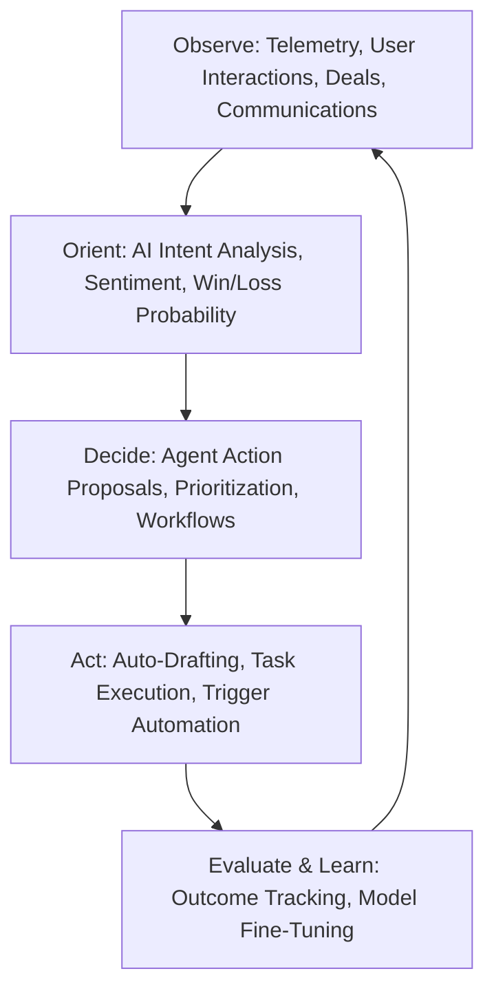
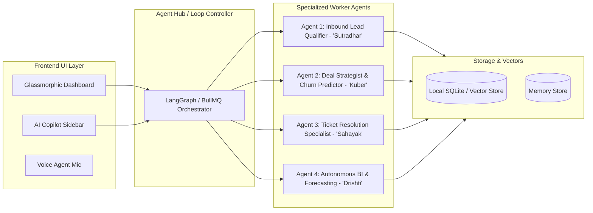

# UPGRADE_LOOP_ENGINEERING.md
## Continuous Autonomous Upgrade & AI-Era Evolution Roadmap

This document establishes the **Loop Engineering (OODA / Autonomous Feedback Loops)** methodology for evolving the system into **Sutradhar AI** from a traditional CRUD dashboard into an **Agentic AI Revenue Engine**.

---

## 1. Loop Engineering Methodology

Loop Engineering operates on continuous cycles:

### The 4 Pillars of Loop Engineering in this System:
1. **Perception Loop**: Ingest leads, WhatsApp logs, emails, ticket escalations, and timeline events.
2. **Reasoning Loop**: Run multi-model heuristics (LLM + local rule graph) to assign deal health scores, churn risks, and lead affinities.
3. **Execution Loop**: Dispatch autonomous actions (draft reply, schedule follow-up, escalate ticket to Slack/WhatsApp, update stage).
4. **Optimization Loop**: Compare predicted win rates with actual outcomes; iteratively tune prompt embeddings and workflow weights.

---

## 2. Multi-Agent System Architecture

---

## 3. Phase-by-Phase Roadmap

### Phase 1: AI Copilot & Voice-to-Action Command (COMPLETED)
- [x] Natural Language Command Palette & Omni-Search (`Ctrl + K`).
- [x] In-app AI Agent Drawer with instant actions:
  - "Draft a strategic enterprise proposal with modular SLA and payment terms".
  - "Summarize all high-priority tickets logged today (Sahayak Agent)".
- [x] Voice note transcription & auto-logging to activities (`/api/ai/voice-log` with Sutradhar AI).

### Phase 2: Predictive Intelligence & Deal Scoring Loop (COMPLETED)
- [x] Dynamic Win Probability & Stall Radar using stage velocity and age matrix (`/api/ai/deal-radar`).
- [x] Risk scoring (Healthy, Warning, Critical) with automatic revenue exposure alerts.
- [x] Interactive Re-score Pipeline controls embedded in the Dashboard Copilot.

### Phase 3: Autonomous Omni-Channel Agents (WhatsApp + Email) (COMPLETED)
- [x] Autonomous Webhook listener for WhatsApp Business API with auto-contact creation (`/webhooks/whatsapp`).
- [x] Auto-enrichment agent (Apollo/Clearbit-style corporate intelligence: headcount, tech stack, readiness) (`/api/ai/enrich-company`).
- [x] Human-In-The-Loop (HITL) follow-up dispatch review queue embedded in Dashboard Copilot (`/api/ai/review-queue`).

### Phase 4: Enterprise Hardening & Edge Offline Sync (COMPLETED)
- [x] Multi-tenant & relational integrity with Foreign Key cascading on SQLite Sovereign store.
- [x] End-to-end audit logging for SOC2 / GDPR compliance (`audit_logs` table & `/audit-logs` endpoint).
- [x] Local Ollama / vLLM air-gapped AI configuration table (`ai_configs` & zero-data-egress architecture).
